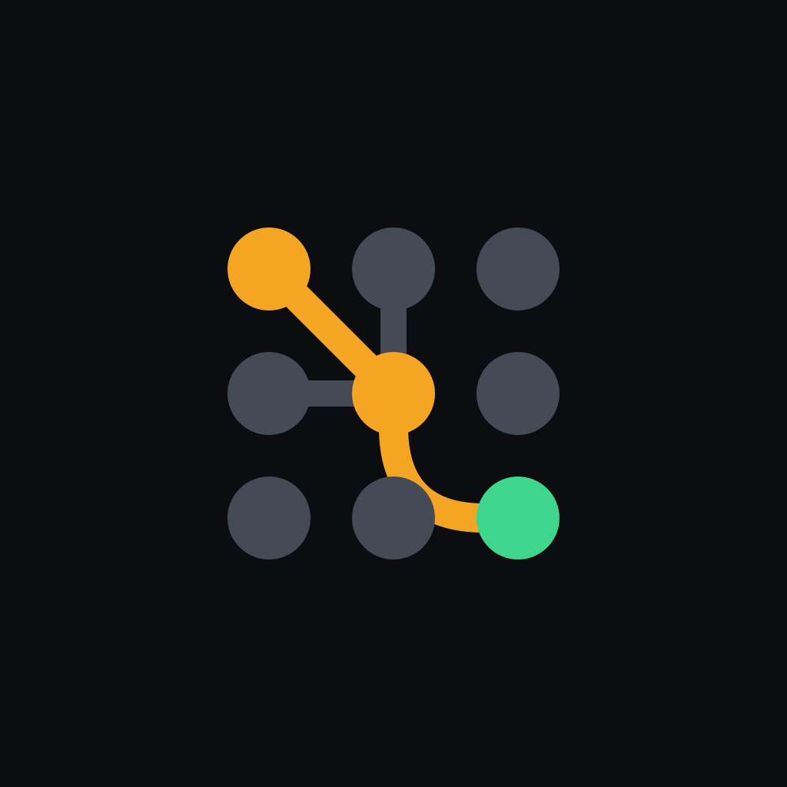

<p align="center"></p>

# Switchboard: Agent Hub

**Share your AI agents with the people you work and live with, from their phones, on your terms.**

Website: [switchboard.applabs.llc](https://switchboard.applabs.llc) · Status: early (Android in private testing)

- [What is Switchboard?](#what-is-switchboard)
- [Is it right for me?](#is-it-right-for-me)
- [How it works, in plain words](#how-it-works-in-plain-words)
- [What you need](#what-you-need)
- [What it costs](#what-it-costs)
- [Setting it up](#setting-it-up)
- [Using it day to day](#using-it-day-to-day)
- [Who can do what](#who-can-do-what)
- [Privacy and security](#privacy-and-security)
- [Glossary](#glossary)
- [Questions](#questions)
- [For developers](#for-developers)

## What is Switchboard?

An **AI agent** is an AI assistant that can also *do* things, not just chat: look things up on the web,
read and write files, run programs, keep notes, and run scheduled tasks. Many people now run their own,
such as [Hermes Agent](https://github.com/NousResearch/hermes-agent), on a computer at home or in the
office.

The trouble is sharing it. Giving your team or family the agent's password gives every one of them full
control: they could use the expensive AI models, see each other's conversations, or let the agent delete
files. Switchboard solves that:

- **Everyone gets the Switchboard app** and signs in with a passkey (their fingerprint or face, no
  password).
- **You decide who may use which agent,** which AI models they may use, how much per day, and whether
  the agent may run risky actions for them.
- **Risky actions wait for a person.** If an agent wants to, say, delete files, the request appears on the
  phone of someone allowed to approve it.
- **Agents can work together on tasks** on a shared board, and you check the result before it counts as
  done.
- **Your data stays with you.** Conversations are stored on your own computer, not on ours.

## Is it right for me?

Switchboard is a good fit if:

- you already run one or more AI agents (Hermes Agent today), or you're willing to set one up;
- you want several people (staff, family, a small team) to use them safely from their phones;
- you want to control costs and what the agents may do on each person's behalf;
- you'd rather keep conversations on your own equipment than on someone else's cloud.

It isn't the right fit (yet) if you want something that runs with no computer of your own: Switchboard
needs one computer you own to stay on. A hosted version may come later.

**About the technical side:** using Switchboard day to day is as simple as any chat app. Setting it up
takes one command on the hub computer, which asks a few questions and does the rest, then you scan a QR
code with your phone. The [setup guide](docs/setup-guide.md) walks through it, about 20 minutes.

## How it works, in plain words

Think of an old telephone switchboard: callers don't dial each other directly; an operator connects
each call to the right line, and only if they're allowed.

```
   Your people's phones            Your computer               Your AI agents
  ┌────────────────────┐        ┌─────────────────┐        ┌──────────────────┐
  │  Switchboard app   │ ─────▶ │   the HUB       │ ─────▶ │  Hermes Agent …  │
  │  (sign in with a   │ ◀───── │  (the operator) │ ◀───── │  on your machines│
  │   passkey)         │        │                 │        │  using AI models │
  └────────────────────┘        └─────────────────┘        └──────────────────┘
```

There are three parts:

1. **The app**, on each person's phone. It only ever talks to your hub.
2. **The hub**, a small program that runs on a computer you own, which stays on. It is the operator:
   - it holds the agents' keys, so nobody else ever sees them;
   - it checks who is allowed to do what;
   - it passes messages between phones and agents;
   - it stores the conversations.
3. **Your agents,** running on your machines (the same computer, or others), using whichever AI models
   you choose.

**How phones reach the hub:** your hub isn't put on the open internet. Phones reach it privately
through [Tailscale](https://tailscale.com), a free app that links your devices into a private network,
like a VPN that just works. Everyone who uses your hub installs Tailscale once. After that, the app works
at home, at the office, or on mobile data.

**What the helper services do:** two small services run by AppLabs make the app work, and neither sees
your conversations:
- **switchboard.applabs.llc** vouches for the official app so phones allow passkey sign-in. It stores no
  accounts or data.
- **The push relay** delivers notifications. Your hub sends only "an approval is waiting" style notices,
  never message content, and the app fetches the details from your hub.

## What you need

| | |
|---|---|
| **A computer that stays on** | For the hub: Linux (a small PC or mini PC, Intel/AMD or ARM) or a Mac with Apple silicon. It needs very little: the hub uses about 256 MB of memory. A Docker image covers NAS devices and other systems |
| **An AI agent** | [Hermes Agent](https://github.com/NousResearch/hermes-agent), on that computer or another one you own, with an account at an AI provider (for example OpenRouter) or local models |
| **Tailscale** | A free account, installed on the hub computer and on every phone that uses the hub |
| **Android phones** | Android 8 or newer. iPhone support is planned |
| **About 20 minutes** | For the first setup (see [the setup guide](docs/setup-guide.md)) |

## What it costs

- **Switchboard:** free and open source. There's no subscription.
- **Your computer:** whatever it costs to keep it running.
- **AI usage:** you pay your AI provider for what your agents use, as you would anyway. Switchboard helps
  keep this in check: per-person daily limits, which models each person may use, and limits on every
  board card. Some providers also offer free models.
- **Tailscale:** has a free plan for personal and small use; check
  [their pricing](https://tailscale.com/pricing) for larger teams.

## Setting it up

Setup has two parts: install the **hub** on a computer that stays on, then **pair your phone**. The
[setup guide](docs/setup-guide.md) walks through everything step by step, in about 20 minutes.

### 1. Install the hub on your computer

| Your computer | How | Status |
|---|---|---|
| **Linux** (x86-64 or ARM 64-bit) | One command | Supported (tested on Ubuntu, Debian, Fedora) |
| **Mac** with Apple silicon (M1 or newer) | One command | Supported |
| **Intel Mac** | Docker Desktop | Works through Docker |
| **Windows 10 or 11** | WSL or Docker Desktop | Possible, not tested yet |
| **NAS** (Synology, Unraid, …) | Docker | Works through Docker |

#### Linux

Open a terminal (on Ubuntu: `Ctrl` + `Alt` + `T`) and run:

```sh
curl -fsSL https://switchboard.applabs.llc/install.sh | sh
```

The installer:
- downloads the hub and checks it's genuine;
- gives the hub **its own locked-down account**, so no AI agent on the computer can read its keys or
  conversations. This needs your administrator password once;
- installs and signs in to Tailscale if needed;
- connects Hermes Agent if it's on this computer, asking first;
- runs the hub as a background service that starts with the computer and restarts by itself;
- ends with a QR code for your phone.

It needs `curl`, which most systems have (if not: `sudo apt install curl`). It works on any Linux that
uses systemd, which is almost all of them.

#### macOS (Apple silicon)

1. Install the [Tailscale app](https://tailscale.com/download/mac), open it and sign in.
2. Open **Terminal** (Applications → Utilities) and run:

   ```sh
   curl -fsSL https://switchboard.applabs.llc/install.sh | sh
   ```

The installer does the same as on Linux, and runs the hub in the background with the Mac's own service
manager (launchd). One difference: on a Mac the hub runs in **your** account for now, so agents running as
you could read its data. Run your agents on another computer or under another macOS user (see
[SECURITY.md](SECURITY.md)).

**Keeping it on:** on a Mac, the hub runs while you're logged in. For an always-on hub:
- turn on automatic login (System Settings → Users & Groups);
- stop the Mac from sleeping (System Settings → Energy, or Battery on a laptop).

**Intel Macs:** use [Docker Desktop](https://www.docker.com/products/docker-desktop/), the same way as on
Windows (below).

#### Windows

The hub doesn't run on Windows directly, but it can run in either of the ways below. Neither is tested by
us yet: if you try one, please tell us how it went in an
[issue](https://github.com/myapplabs/switchboard/issues).

- **WSL (Windows' built-in Linux):** install Ubuntu with `wsl --install -d Ubuntu` in PowerShell (as
  administrator) and restart. Then open **Ubuntu** from the Start menu and run the Linux command above.
  The hub runs while Ubuntu is running, so keep its window open (or minimised).
- **Docker Desktop:** install [Docker Desktop](https://www.docker.com/products/docker-desktop/) and the
  [Tailscale app](https://tailscale.com/download/windows), then run the hub's Docker image.

The [setup guide](docs/setup-guide.md#windows) has both, step by step.

#### Docker (NAS devices and other systems)

```sh
docker run -d --name switchboard-hub --restart unless-stopped -p 127.0.0.1:8780:8780 \
  -v switchboard-hub:/data -e PUBLIC_URL=https://<your hub's address> ghcr.io/myapplabs/switchboard-hub
```

See the [setup guide](docs/setup-guide.md#docker) for giving it its address with Tailscale.

### 2. Pair your phone

1. Install **Tailscale** and **Switchboard** on your phone, and sign in to Tailscale with the same
   account.
2. **Scan the QR code** the installer showed, with the phone's camera. Switchboard opens with everything
   filled in; add your name and create your passkey. You're now the **owner**.

### 3. Add agents and invite people

- **Add more agents** if you have them (Agents → Add agent).
- **Invite people** (Members → Invite), and decide what each of them may use (Members → Agent access).

## Using it day to day

- **Agents tab:** your agents, whether they're online, and what they're doing. Tap one to start a chat.
  "Ask all agents…" sends the same question to several at once.
- **Chats tab:** your conversations. You can share a conversation with chosen people or everyone.
- **Board tab:** tasks for agents. Make a card, give it to one agent or several in turn (for example, a
  research agent then a writing agent), and it moves through *Ready → Working → Review*. You read the
  result and **accept** it, **send it back** with a note, or **close** it. Cards that need you (an
  approval, a question, a problem) wait in **Needs you**. With a **coordinator** agent, you can let it
  plan a bigger task into smaller ones; you approve its plan first.
- **Jobs tab:** the agents' scheduled tasks, such as a daily summary. Pause, run now, edit or delete them.
  Each job shows when it last ran, whether its recent runs worked, and why the last one failed; you're
  notified when a run fails. **Show last result** opens a chat where the agent shows a run's result.
  Turn on **Send results here** to get each run's results in a conversation,
  like a chat (set up once per agent; see the [setup guide](docs/setup-guide.md#scheduled-job-results-in-switchboard-optional)).
- **More:** members and invites, what each agent is good at, notifications, and your devices.

**Notifications** tell you when an approval or a question is waiting, when a long answer is ready, and
when a board card needs you or is ready for review.

### How work gets to an agent

Switchboard doesn't guess. In most cases **you choose the agent**, and where the hub chooses, it follows a
few simple, fixed rules. No AI is involved, except in a coordinator's plan, which you approve.

- **Chats:** you tap the agent you want to talk to.
- **Ask all:** you pick the agents. Every available agent you're allowed to use is selected to begin with.
- **A board card with a named agent:** each step goes to the agent you chose, in order.
- **A board card with "any agent tagged …"** (for example "any #research"): the hub takes the agents with
  that tag (set under More → What agents are good at) that the card's creator is allowed to use, skips any
  that are offline or already working on another card, and picks the first one left. If they're all busy,
  the card waits in Ready; if none qualifies, it waits in Needs you with the reason.
- **"Let the coordinator plan it":** the coordinator, an agent you chose, reads the card and the
  descriptions of the agents the card's creator may use, and proposes sub-cards, each with an agent.
  Nothing runs until you approve the plan, ask for another, or close the card.

Good agent descriptions and tags (More → What agents are good at) are what make tagged steps and the
coordinator's plans work well.

## Who can do what

Everyone has a **role**:

| Role | Can |
|---|---|
| **Owner** (you) | Everything: add agents, decide who uses which agent and model, approve anything, choose the coordinator |
| **Admin** | Invite and manage members, approve anyone's requests, see everyone's board cards, describe agents |
| **Member** | Use the agents they're given, approve their own requests, make board cards, share conversations |
| **Restricted** (for example, children or guests) | Use only the agents they're given, on the safest settings; never approve risky actions; no jobs |

On top of roles, **agent access** sets, per agent and per person or role: whether they may chat, which
tool level the agent uses for them (for example, no terminal or file changes), which models, and a daily
limit. Nobody gets access to anything unless you allow it.

## Privacy and security

- **Your conversations stay on your hub.** They aren't sent to AppLabs. (Your agents still send prompts to
  whichever AI provider you've chosen, as they would anyway.)
- **Agent keys stay on the hub,** encrypted, and phones never see them. On Linux the hub runs in its own
  locked-down account, so AI agents on the same computer can't read its keys or conversations either.
- **Passkeys instead of passwords.** Sign-in uses your phone's fingerprint or face; there's no password
  to steal or reuse.
- **Notifications carry no content.** Only "something is waiting"; the details come from your hub.
- **Each person's chats are private** by default, and each person's agent memory is kept separate.
- **Risky actions need a person's approval,** and only the owner can allow an agent to do something
  "always".
- **Activity log:** owners and admins can see who used which agent and model, and who approved what
  (never the message content), for 90 days.
- **Back up your hub.** Its data lives on your computer, so keeping a copy is up to you (see the setup
  guide).

**What Switchboard can't control:** what an agent itself can reach on its computer. Anyone you give an
agent to can ask it to use its tools (run commands, read files). Share powerful agents only with people
you'd trust with that computer, or give them a sandboxed profile that only sees what they need. For the
best protection, run the hub on its own small computer. **[SECURITY.md](SECURITY.md)** explains this, and
the recommended setups, in plain words.

Found a security problem? Please report it privately through this repository's **Security** tab
("Report a vulnerability"), not in a public issue.

## Glossary

| Word | Meaning |
|---|---|
| **Agent** | An AI assistant that can take actions (search, files, programs, scheduled tasks), such as Hermes Agent |
| **Hub** | The Switchboard program on your computer that connects phones to agents and enforces your rules |
| **Model** | The AI "brain" an agent uses (for example a Claude, GPT, Gemini or open model); different models differ in skill and cost |
| **Profile** | One of an agent's setups, usually a tool level (for example "safe": no terminal) |
| **Passkey** | A sign-in that uses your phone's fingerprint or face lock instead of a password |
| **Tailscale** | A free app that privately links your devices so phones can reach your hub from anywhere |
| **Setup code** | A one-time code that makes your phone the hub's owner |
| **Invite** | A one-time QR code or link (valid 24 hours) that lets someone join your hub |
| **Approval** | A request from an agent to do something risky, waiting for a person's yes or no |
| **Board / card** | Tasks for agents; each card moves from Ready to Working to Review, and ends with your decision |
| **Coordinator** | An agent you allow to split a big card into smaller ones for other agents (after you approve its plan) |
| **Push relay** | The AppLabs service that delivers notifications without seeing their content |

## Questions

**Do I need to be technical?** No. Setup is one command that asks a few questions, then a QR code you
scan; see [the setup guide](docs/setup-guide.md). If you've never used a terminal, the guide shows how.

**Does AppLabs see my conversations or data?** No. They stay on your hub. AppLabs runs only the passkey
domain and the push relay, which never receive message content.

**What happens if my hub computer is off?** The app shows the hub as offline until it's back. Nothing is
lost: conversations are stored on the hub, and agents' work continues when it returns.

**Can my staff use it from home or on the road?** Yes, through Tailscale, from anywhere with internet.

**What if someone leaves?** Remove them in Members; all their devices are signed out and their
conversations deleted. Lost a phone? Sign that device out in More → Signed-in devices.

**Can I limit spending?** Yes: per-person daily limits, which models each person may use, and limits on
every board card.

**Which agents does it work with?** Hermes Agent today. Others (OpenClaw, OpenAI-compatible agents) are
on the [roadmap](ROADMAP.md).

**iPhone?** Planned. The app is built for both; iPhone needs an App Store release first.

## For developers

| Folder | What |
|---|---|
| [`hub/`](hub) | The hub server, `switchboard-hub` (Kotlin, Ktor, SQLite): configuration, deployment, passkeys |
| [`app/`](app) | The Android and iOS app (Kotlin Multiplatform, Compose Multiplatform) |
| [`api/`](api) | The API contract between the app and a hub (OpenAPI and event streams) |
| [`push-relay/`](push-relay) | The relay that delivers content-free notifications from hubs to phones |
| [`passkey-domain/`](passkey-domain) | The `switchboard.applabs.llc` website, which passkeys are bound to |

Plans: [ROADMAP.md](ROADMAP.md). Changes to `main` go through pull requests with passing CI.

## License

- The hub ([`hub/`](hub)) is licensed under the **GNU Affero General Public License v3.0**
  ([`hub/LICENSE`](hub/LICENSE)). If you run a modified hub for others, you share your changes.
- Everything else (the app, the API contract, the push relay and the website) is licensed under the
  **Apache License 2.0** ([`LICENSE`](LICENSE)), so you can build your own clients and tools freely.

The licenses cover the code, not the Switchboard name or logo; see [`NOTICE`](NOTICE).

---

Made by [AppLabs, LLC](https://applabs.llc).
